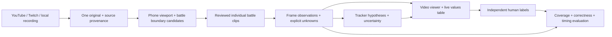

# Video-to-state pipeline

This document retains the original local development history. The Git checkout
includes code, profiles and dataset metadata; the referenced recordings, generated
logs and historical viewer outputs remain local. See README.md for portable setup.

Target: import one YouTube video or Twitch VOD, find its individual battles, read
each frame, and provide time-aligned observations and reconstructed game states.
Decoding every frame does not establish that every game state was identified.



## Current reproducible steps

1. `python import_source.py URL` inspects metadata or registers existing media.
   Add `--download` to download one 720–1080p MP4 stream with the installed yt-dlp.
   Stream selection may omit audio on YouTube; actual audio presence is recorded.
   Twitch VOD intake is implemented but not tested against a specific VOD yet.
   Access and extractor failures are surfaced. There is no login/cookie import.
   Signed download URLs and full extractor payloads are not saved.
2. `sources/<platform>/<id>/source.json` records the source, downloader version,
   media facts and checksum. Existing reference media is reused. Viewport and
   battle boundaries still require review; ingestion never invents those labels.
3. `segment_battles.py` discovers battle candidates using central 3→2→1
   countdowns, header/party resets and result cues. `extract_battles.py` exports
   phone clips with compressed per-frame original-PTS alignment. It found nine
   battles in each source, including a second battle accidentally combined in
   the old Henry 07. Validated `henry-07a` and `henry-07b` replace that entry; the
   combined original is retained and excluded from the active library. Corrected
   intervals are in `fixtures/battle-segments-v2.json`. Context boundaries remain
   approximate; action time zero and internal video edits are unverified.
4. The active library has 56,704 raw observations covering all 18 clips, generated
   with preserved v3 reader inputs. OCR runs every 0.5 seconds; cached text is
   marked stale. `refine_saved_readings.py` adds separate v4 patches using saved
   grade cues, current-frame header marker positions and causal health estimates;
   it preserves the raw log and archives prior display packages. Earlier first-
   battle runs remain in `dataset/predictions-frozen-v1`. `dataset_tools.py predict`
   can regenerate the baseline into a separate folder.
5. `build_lazy_viewer.py` rebuilds the HTML viewer. The live values table follows
   playback of saved observations. Review inputs start blank; hide predictions
   while annotating. Export labels and evaluate them with `dataset_tools.py`.

Exact split, prediction and evaluation commands are in `dataset/README.md`.
The split stays at source level: nine Reis development clips and nine previously
exposed Henry regression clips. A new untouched source is needed for an unbiased
final test. Prediction files never serve as their own ground truth.

## One-command ingestion

Double-click `Import Battle Video.cmd` for the complete interactive workflow,
including refinement and opening the viewer. The lower-level baseline commands are:

```text
python run_video_pipeline.py https://youtu.be/qSaL7jM9NbA --stage track
python run_video_pipeline.py https://www.twitch.tv/videos/VIDEO_ID --download --profile profiles/YOUR_LAYOUT.json --stage track
```

Known videos reuse their registered originals and layout profiles. A new recording
requires a calibrated profile; its layout is never guessed from a creator name.
`--stage detect` scans without making clips; `--stage extract` makes clips without
predictions. Hash-checked caches reuse valid results. `--only CANDIDATE_ID
--predict-seconds 3` is an explicitly partial smoke check. New-source evaluation
partitions must be assigned explicitly.

`phase` contains a current screen cue. `phase_estimate` separately marks bounded
causal continuity as inferred, such as after declining a shield. Enlarged header
and move OCR uses the shared species/move lexicon. A visible bar can settle in an
unclassified view with a recent readable identity. Recognized charge animations,
mixed-color bars and conflicting readings block health estimates. Earlier analysis
versions and tracker outputs survive a screen refresh; videos are not copied again.

## Referenced battle-logic repository

Reference: https://github.com/Solaceonx/pokemon_go

Inspected revision: `56a05ea291ed178594f6888a909f969600aba2df`. The local reference
checkout is `references/solaceonx-pokemon-go`; it is not executed or imported into
the reader. Its `docs/agent_instructions.md` uses the same observation contract as
our existing tracker bundle: battle-relative `t`, species, HP fractions, CP,
shields, party counts, visible own energy/switch clock and observed charged moves.
Missing fields are omitted. Charged animation events attach to the first reviewed
fighting observation afterward. Exact battle start and internal video cuts require
separate review; a clip start is not automatically battle time zero.

Compared with the supplied bundle, `pogo/gamedata.py` has identical text. The newer
`pogo/tracker.py` adds matchup facts: active moves, computed damage/energy, charged
readiness and optional alternative opponent moves. `scripts/track.py` includes
those alternatives in its final state. These are downstream hypotheses based on
selected stats/moves, not screen measurements. Existing bundle behavior and source
remain intact. Updating that engine needs a separate compatibility check.

The reference's own status describes the tracker as tested on simulated cameras;
that does not validate recognition of real iPhone footage. We measure our visual
reader independently and keep its observations separate from tracker inference.

## What complete state tracking will require

- Scene coverage: countdown, normal fighting, charged warning/shield decision,
  every type-specific minigame, charge resolution, voluntary switches, our
  replacement choice, opponent replacement wait, entering Pokémon, result and
  edited/occluded footage. Review the first/last frame of transitions, not just a
  few representative screenshots.
- Visible state: correct identity/form and CP, health extent/error range, shield
  and party counts, button positions/readiness, switch clock, visible own energy,
  text effects and named moves. Do not fabricate zero when a field disappears.
- Reconstructed state: observed attack timing, identity history across switches,
  feasible whole-number HP/damage, possible move sets, opponent energy ranges and
  switch timing. Preserve assumed stats and unresolved hypotheses explicitly.
- Evaluation: separate visible-field coverage and correctness, health absolute
  error, event precision/recall and transition-time error. Add full independently
  annotated battles and untouched recordings across devices/layouts. The present
  three human frame labels only verify the evaluation plumbing.

Current health abstentions are mostly caused by unclassified scenes and missing
identity text, followed by unstable/missing bar outlines and mixed damage colors.
Use `python health_diagnostics.py` for counts on all saved active clips. Further
reader work should target scene/identity continuity and bar localization;
relaxing unknowns into unverified HP would inflate coverage without establishing
correctness.

## Frozen baseline and experimental speed work

`dataset/reader-snapshots/v3/inputs.json` fingerprints preserved code, game-data,
profile and template inputs for the full-library run. Media hashes and source PTS
remain in the dataset and each battle folder. Archives contain earlier analysis;
no video is copied during a screen refresh.
The first Reis/Henry v3 packages predate generation-time template fingerprinting;
their publication hashes are recorded with verification explicitly unavailable.
Henry 01 also lacks a generation-time original-source checksum. Later 16 runs
recorded these inputs during generation. Shared OCR models/runtime inputs are
fingerprinted in `dataset/reader-snapshots/v3/runtime-inputs.json`.

`dataset/reader-snapshots/v4-refinement/inputs.json` preserves the refinement code
and layouts. Each battle records raw/video/profile/code/patch checksums. Re-running
the unchanged refinement reuses all 18 results without writing duplicate analysis.
`validate_library.py` independently decodes the media and verifies every frame's
original PTS, causal evidence and display reconstruction from raw plus patch.

`build_lazy_viewer.py` keeps each battle's display package compressed until it is
selected, and discards inactive readings. This avoids parsing every battle into
memory at startup. Folder refresh picks up finished readings during playback.

`roi_ocr.py` is an experimental alternate OCR adapter: fixed header recognition,
smaller scene regions and fallback on uncertain strips. Six selected-frame checks
matched baseline identities/CP and phases, with speed varying by scene. It is not
used for the frozen baseline and has no established real-time guarantee.

`dataset/assistant-visual-review.jsonl` contains eight assistant-reviewed Henry
frames inspected without predictions. `check_visual_review.py` compares them with
saved readings, explicitly separately from independent human labels/accuracy.

## Current checks and limits

All 18 active clips passed independent decoding and per-frame alignment checks:
56,704 frames over 2,049 seconds. The source-level split verifies as nine development
and nine exposed regression clips. 107 Python tests pass; real Chrome checks pass
for playback, seeking, causal timestamps, live values, folder import and missing data.

The current contextual scene classifier assigns a scene on 84.9% of frames. This
includes inference and is coverage, not accuracy. Settled visible-health estimates
cover only 5.6% of own-side frames and 6.3% of opponent frames; animation and identity
gaps still prevent continuous health reconstruction. Raw bar measurements remain
available separately. Whole-number HP needs a verified maximum HP.

The eight exposed assistant checks agree on 36 of 40 known values. Four phase
checks disagree about charged-attack waiting versus resolution; some images do
not establish that transition by themselves. These labels are retained with their
review provenance, not rewritten to match predictions. Three user phase frames
pass the contextual check, but that tiny sample is not general accuracy. The Henry
human benchmark remains unscored because it has no independent human labels.

Real-time iPhone capture/control, complete type-specific minigame recognition,
numerical energy and switch-clock measurement, reviewed full-battle ground truth,
and an untouched final evaluation source are still outstanding.
